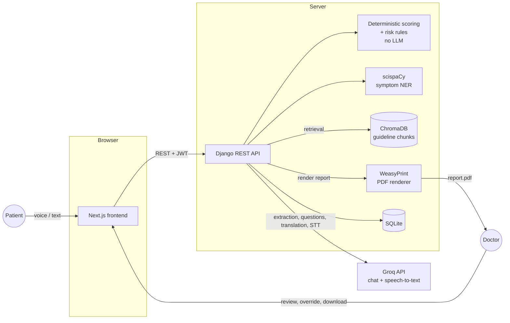

# Multilingual Clinical Dialogue System

An AI-powered lifestyle assessment web app, built for the Indian primary-care setting.
A patient describes symptoms by voice or text in their own language. An AI assistant
asks about 8 lifestyle areas (sleep, exercise, diet, water intake, stress, sitting
hours, smoking, alcohol), extracts structured answers, computes a deterministic
Lifestyle Wellness Score, detects lifestyle-related risk factors, and generates
guideline-grounded recommendations. A doctor reviews everything as a structured
clinical summary and downloadable PDF report.

**This is a screening and documentation aid.** It never diagnoses, never prescribes or
names medications, and always defers to the doctor — see [Limitations](#limitations).

See `CLAUDE.md` for the full product and architecture brief this project was built from.

## Architecture



The conversation engine (`backend/assessment/engine/`) is a deterministic state
machine — the LLM fills in one slot of structured data per turn, but which slot gets
asked next, when the questionnaire ends, and whether a message escalates the
consultation are all plain Python, not LLM decisions. Scoring and risk-flagging
(`backend/assessment/scoring.py`, `backend/assessment/risk_rules.py`) never call the
LLM at all — see [docs/scoring.md](docs/scoring.md) for the full table.

## Tech stack

| Layer | Technology |
| --- | --- |
| Backend | Python 3.10.11, Django 5, Django REST Framework, djangorestframework-simplejwt |
| Database | SQLite3 |
| LLM + speech | Groq API (chat completions + Whisper speech-to-text), via the official `groq` SDK |
| Medical NLP | scispaCy (`en_ner_bc5cdr_md`) + regex number parsing — local, no LLM |
| RAG | ChromaDB (persistent, local), default ONNX `all-MiniLM-L6-v2` embeddings — no torch |
| PDF reports | WeasyPrint |
| Frontend | Next.js (App Router), plain JavaScript/JSX (no TypeScript), Tailwind CSS, Recharts |
| Auth | JWT (djangorestframework-simplejwt) |
| Deploy target | Ubuntu VPS — Nginx + Gunicorn + systemd, GitHub Actions over SSH (see [Deployment](#deployment)) |

## Local setup

Requires Python 3.10.11 and Node.js (matching the frontend's Next.js 16 requirement).
All commands below assume you're in the repo root unless noted.

### Backend

```bash
cd backend
python -m venv venv
venv\Scripts\activate        # Windows; use `source venv/bin/activate` on macOS/Linux
pip install -r requirements.txt

cp .env.example .env         # then fill in GROQ_API_KEY - see Environment variables below
python manage.py migrate
python manage.py createsuperuser   # optional, for /admin/
python manage.py ingest_guidelines # populate the RAG knowledge base from backend/knowledge_docs/
python manage.py seed_demo         # optional - 1 doctor + 3 demo patients/consultations, see below
python manage.py runserver
```

With `GROQ_MOCK=1` (the `.env.example` default), every Groq call returns deterministic
fixture data — the whole backend, including `seed_demo`, works fully offline with no
API key needed for a first run. Set `GROQ_MOCK=0` and provide a real `GROQ_API_KEY` to
use the live API.

`ingest_guidelines` extracts, chunks, and embeds every PDF in `backend/knowledge_docs/`
into the local ChromaDB collection. Without it, RAG retrieval finds nothing and
recommendations fall back to generic guidance (`backend/assessment/data/fallback_recommendations.json`)
instead of guideline-cited text — run it once before trying the full flow.

`seed_demo` creates one doctor and three patients, each with a completed (or
escalated) consultation covering a different scenario, and prints every login at the
end:

| Scenario | Patient | Language | Expected result |
| --- | --- | --- | --- |
| Poor-band lifestyle | `patient_poor` | English | Wellness score 34, band "Poor" |
| Healthy lifestyle | `patient_healthy` | Hindi | Wellness score 80+, band "Good" |
| Emergency escalation | `patient_escalated` | English | Status "Escalated", chest-pain risk flag, no score/recommendations (by design — see `assessment/pipeline.py`) |

Re-running `seed_demo` deletes and recreates these three accounts, so it's safe to run
again. It forces `GROQ_MOCK` on for its own run regardless of your `.env`, since the
recommender's LLM step has no deterministic fixture to draw from otherwise.

### Frontend

```bash
cd frontend
npm install
cp .env.local.example .env.local   # NEXT_PUBLIC_API_URL, defaults to http://localhost:8000
npm run dev
```

Open http://localhost:3000. Sign in as a patient to start a consultation, or as
`doctor` / `demo1234` (after running `seed_demo`) to see the doctor queue.

### Tests

```bash
cd backend
pytest
```

Runs fully offline in mock mode regardless of `backend/.env`'s `GROQ_MOCK` value —
see `config/test_settings.py`. `frontend` has no automated test suite yet; `npm run
lint` runs ESLint.

## Environment variables

### Backend (`backend/.env`, see `backend/.env.example`)

| Variable | Purpose | Default |
| --- | --- | --- |
| `SECRET_KEY` | Django secret key | *(must be set)* |
| `DEBUG` | Django debug mode | `True` |
| `ALLOWED_HOSTS` | Comma-separated allowed hosts | `localhost,127.0.0.1` |
| `CORS_ALLOWED_ORIGINS` | Comma-separated frontend origins allowed to call the API | `http://localhost:3000` |
| `GROQ_API_KEY` | Groq API key | *(empty)* |
| `GROQ_CHAT_MODEL` | Chat completions: extraction, question generation, translation | `openai/gpt-oss-120b` |
| `GROQ_STT_MODEL` | Speech-to-text transcription | `whisper-large-v3` |
| `GROQ_TRANSLATE_MODEL` | Audio-to-English translation (only `whisper-large-v3` supports Groq's `/audio/translations` today) | `whisper-large-v3` |
| `GROQ_MOCK` | `1` returns deterministic fixtures for every Groq call (offline dev/tests), `0` calls the live API | `1` |
| `GROQ_REASONING_EFFORT` | `reasoning_effort` sent to reasoning-capable chat models only | `low` |
| `GROQ_REASONING_FORMAT` | `reasoning_format` sent to models that support it | `hidden` |
| `WEASYPRINT_DLL_DIRECTORIES` | Windows only — folder holding WeasyPrint's native DLLs if not on PATH | *(empty)* |

Which models a given `GROQ_CHAT_MODEL` actually receives `reasoning_effort` /
`reasoning_format` / structured-outputs (`json_schema`) params for is decided by the
capability tables at the top of `backend/core/services/groq_client.py`
(`REASONING_EFFORT_MODELS`, `REASONING_FORMAT_MODELS`, `JSON_SCHEMA_MODELS`) — update
those if you switch models or Groq changes what a model supports.

Run `python manage.py check_groq` after changing `GROQ_CHAT_MODEL` or `GROQ_STT_MODEL`
to confirm both still exist for your API key.

### Frontend (`frontend/.env.local`, see `frontend/.env.local.example`)

| Variable | Purpose | Default |
| --- | --- | --- |
| `NEXT_PUBLIC_API_URL` | Base URL the frontend calls for the Django API | `http://localhost:8000` |

## Scoring & risk rules

The Lifestyle Wellness Score and every risk flag are computed by plain, deterministic
Python — no LLM is involved. Full weights, bands, and rule thresholds are documented
in [docs/scoring.md](docs/scoring.md).

## API endpoints

All endpoints except registration, login, token refresh, and the two root/health
checks require a JWT (`Authorization: Bearer <token>`).

| Method | Path | Purpose |
| --- | --- | --- |
| GET | `/` | Service root info |
| GET | `/api/health/` | Health check (DB connectivity) |
| POST | `/api/auth/register/` | Patient self-registration |
| POST | `/api/auth/login/` | Obtain JWT access/refresh tokens |
| POST | `/api/auth/refresh/` | Refresh an access token |
| GET/PATCH | `/api/auth/me/` | Current user's profile |
| POST | `/api/auth/consent/` | Record patient consent |
| GET/POST | `/api/consultations/` | List own consultations / start a new one (patient) |
| GET | `/api/consultations/{id}/` | Consultation detail (patient's own) |
| GET | `/api/consultations/{id}/state/` | Status, per-slot fill state, current profile (patient) |
| POST | `/api/consultations/{id}/text/` | Send a text message, advance the conversation |
| POST | `/api/consultations/{id}/audio/` | Send a voice message (transcribed, then advances the conversation) |
| POST | `/api/consultations/{id}/reanalyse/` | Re-run scoring/risk-flags/recommendations (doctor) |
| GET | `/api/doctor/consultations/` | Doctor queue (filterable, searchable) |
| GET | `/api/doctor/consultations/{id}/` | Full clinical detail view (doctor) |
| PATCH | `/api/doctor/consultations/{id}/lifestyle/` | Override an extracted lifestyle value (doctor) |
| POST | `/api/doctor/consultations/{id}/notes/` | Add a doctor's note |
| POST | `/api/doctor/consultations/{id}/review/` | Mark a consultation reviewed |
| GET | `/api/consultations/{id}/report.pdf` | Download the clinical summary PDF (patient's own, or any doctor) |
| — | `/admin/` | Django admin |

## PDF reports (WeasyPrint)

`GET /api/consultations/{id}/report.pdf` renders the clinical summary via
[WeasyPrint](https://doc.courtbouillon.org/weasyprint/). Fonts (Noto Sans +
Devanagari/Tamil/Telugu/Bengali/Kannada/Gujarati/Malayalam, so Indic scripts render
instead of empty boxes) are bundled locally under `backend/reports/static/fonts/` and
loaded via `@font-face` — no internet access needed at render time.

WeasyPrint needs native Pango/cairo/GObject libraries that aren't pulled in by `pip
install`. On the Ubuntu deploy target, install:

```
sudo apt install libpango-1.0-0 libharfbuzz0b libpangoft2-1.0-0 libharfbuzz-subset0
```

(add `libffi-dev libjpeg-dev libopenjp2-7-dev` too if installing from source rather
than a wheel). Without these, `import weasyprint` raises `OSError: cannot load
library 'libgobject-2.0-0'` — `backend/reports/pdf.py` imports WeasyPrint lazily
inside the render function specifically so the rest of the app still starts and
every other test still runs on a machine that doesn't have them (e.g. this project's
Windows dev box, where the PDF endpoint's own test mocks the renderer for that
reason — see `reports/tests.py`).

If WeasyPrint can't load its native libraries, `python manage.py check` (and
`runserver`/`migrate`, which run checks too) prints a `reports.W001` warning at
startup, so it's visible immediately rather than only on the first "Download PDF"
click — see `backend/reports/checks.py`.

### Windows: installing the GTK runtime without admin/Chocolatey

Chocolatey's `gtk-runtime` package needs write access to `C:\ProgramData\chocolatey`,
which requires admin rights. MSYS2 doesn't:

1. Download the [MSYS2 installer](https://www.msys2.org/) and install it to a folder
   **you own**, e.g. `C:\Users\<you>\msys64` — not `C:\msys64` — so no admin prompt is
   needed. Keep every other default.
2. From the Windows Start menu, open **MSYS2 UCRT64** (not the plain MSYS2 shell —
   WeasyPrint's official docs specifically call out the UCRT64 environment).
3. Run:
   ```
   pacman -S mingw-w64-ucrt-x86_64-pango
   ```
   This pulls in cairo and GObject as dependencies too — it's the one package you
   need. Accept the default package selection when prompted.
4. Close the MSYS2 shell. No PATH or system settings need to change.
5. In `backend/.env`, set `WEASYPRINT_DLL_DIRECTORIES` to that install's `ucrt64\bin`
   folder (see `backend/.env.example`), e.g.:
   ```
   WEASYPRINT_DLL_DIRECTORIES=C:\Users\<you>\msys64\ucrt64\bin
   ```
   WeasyPrint (53+) reads this env var directly to locate the DLLs, so this is the
   only configuration step — no admin rights and no PATH edits anywhere.
6. Verify with `python -m weasyprint --info` (from the activated venv) or by
   re-running `python manage.py check` — the `reports.W001` warning should be gone.

## Microphone access requires HTTPS

Voice input uses the browser's `getUserMedia` API, which browsers only grant on a
secure context: HTTPS, or `localhost` during local development. It will silently fail
(or the browser won't even prompt for permission) over a plain `http://` connection to
anything other than `localhost` — this is a browser platform restriction, not
something this app can work around. The deploy config (see below) always serves the
app over HTTPS for this reason, and the nginx `Permissions-Policy` header explicitly
allows `microphone=(self)`.

## Limitations

- This is a **screening and documentation aid**, not a diagnostic tool. It never
  diagnoses, prescribes, or names medications.
- It has not been clinically validated. The Lifestyle Wellness Score and risk flags
  are a deterministic scoring convention (see [docs/scoring.md](docs/scoring.md)), not
  a validated clinical instrument.
- LLM extraction of structured lifestyle data from conversational text can be wrong —
  a patient's phrasing can be misread, or a value missed entirely. This is why every
  extracted value carries its source quote and confidence, and **the doctor can review
  and override every single value** before it affects the score (`backend/assessment/pipeline.py`,
  the doctor lifestyle-override endpoint).
- A consultation with fewer than 4 of the 8 lifestyle slots answered is deliberately
  left unscored rather than shown with a misleadingly precise number — see
  `assessment/pipeline.MIN_FILLED_SLOTS`.
- Always defers to the doctor: the app never tells the patient a result or a next
  step beyond "your answers are ready for your doctor to review."

## Future enhancements

Not built yet, but natural next steps for this product:

- Wearable device integration (sleep, activity, heart-rate data feeding the wellness
  score directly instead of self-report)
- AI-assisted nutrition planning
- Weekly progress tracking across consultations
- Medication adherence reminders
- A dedicated mental health assessment module
- Voice emotion analysis alongside speech-to-text
- Multilingual health coaching between consultations, not just at intake

## Deployment

Ubuntu VPS, Nginx + Gunicorn + systemd, deployed via GitHub Actions over SSH on every
push to `main`. See:

- `deploy/nginx/bedside.conf` — HTTPS site config (HTTP -> HTTPS redirect, certbot
  placeholders, routes `/` to Next.js, `/api/` and `/admin/` to Gunicorn over a Unix
  socket, `/static/` and `/media/` served directly, security headers)
- `deploy/systemd/bedside-gunicorn.service` — 3 Gunicorn workers, 120s timeout (LLM
  calls can be slow)
- `deploy/systemd/bedside-nextjs.service` — `next start`
- `.github/workflows/deploy.yml` — on push to `main`: SSH in, `git pull`, reinstall
  backend deps, `migrate`, `collectstatic`, `npm ci && npm run build`, restart both
  services

Both the nginx config and the systemd units assume the app is checked out at
`/opt/bedside` under a dedicated `bedside` system user, and that the deploy user has
passwordless `sudo` for exactly the two `systemctl restart` commands the workflow
runs (not sudo in general). GitHub repository secrets needed: `VPS_HOST`, `VPS_USER`,
`VPS_SSH_KEY` (a private key whose matching public key is authorized on the VPS for
`VPS_USER`).

Gunicorn is POSIX-only (it imports `fcntl`) and cannot be run or tested on Windows —
`deploy/systemd/bedside-gunicorn.service` can only be verified on the actual Ubuntu
target, unlike everything else in this repo.
